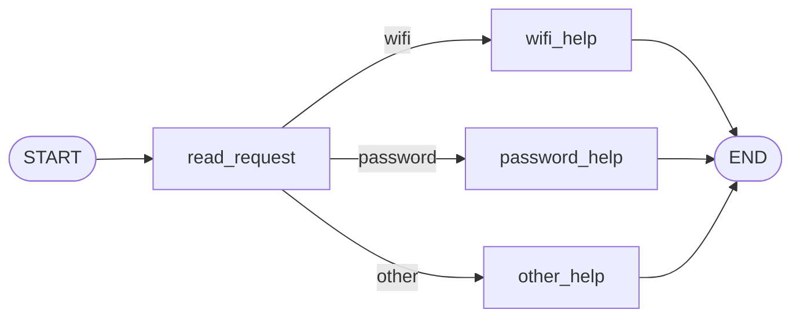
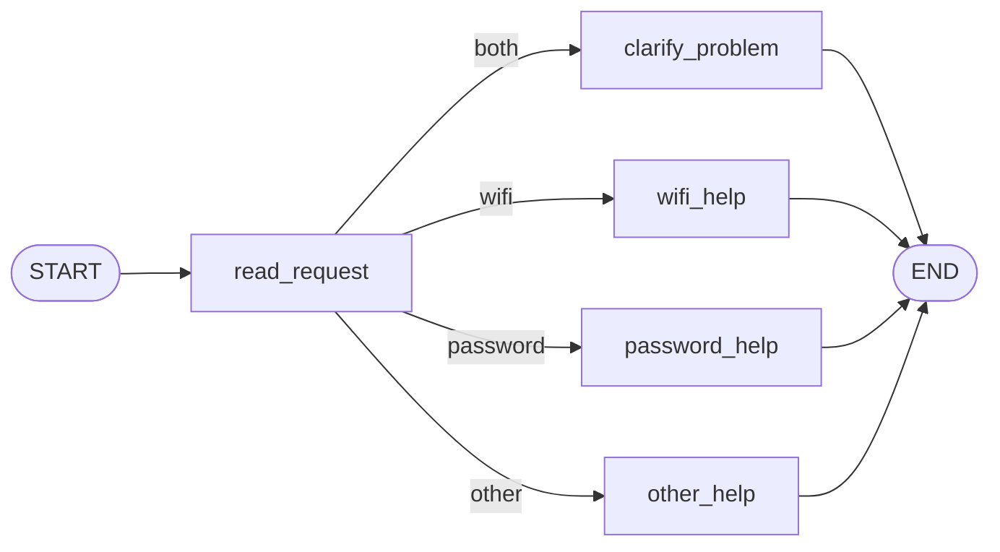
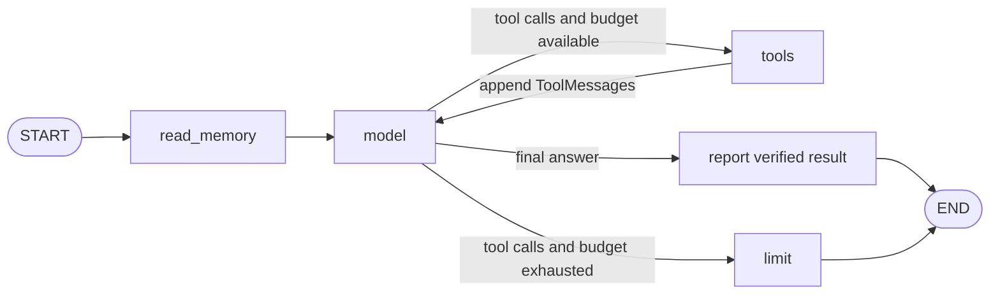

# HW5 — University IT helpdesk

## Part 1 — How the graph works

The input sets `message`. The `read_request` node reads that field,
case-folds it, and writes `category`. The help nodes write `reply`.
The Wi-Fi and password nodes read their corresponding entries in
`data/helpdesk.json`, and `other_help` returns a question.

The graph merges a node's partial update into state. The conditional
edge reads the merged `category` and chooses the next node. Every node
receives the current state, including the original message. `START`
marks the entry edge and `END` marks completion. Compiling validates
the graph structure and creates a runnable graph that can stream updates.

### Predictions and observations

The predictions were recorded in [part1-plan.md](part1-plan.md) before the first run.
The full traces show `category` appearing after the first node and `reply`
after the second.

| Input | Predicted terminal node | Observed terminal node | Explanation |
| --- | --- | --- | --- |
| I cannot connect to Wi-Fi. | `wifi_help` | `wifi_help` | The hyphenated keyword matches. |
| I forgot my PASSWORD. | `password_help` | `password_help` | Case-folding matches uppercase input. |
| My laptop screen is broken. | `other_help` | `other_help` | Neither keyword occurs. |
| My Wi-Fi password does not work. | `wifi_help` | `wifi_help` | The original Wi-Fi condition returns before the password condition. |

### Changed graph

In [S05](outputs/S05.json), `read_request` wrote `category: both`,
then `clarify_problem` asked which problem the user wants to solve first.
Checking for both topics before checking for Wi-Fi creates the new branch.
LangGraph controls state merging, traversal, and termination. Python
determines the category, the routing key, and the text returned by each node.

## Part 2 — Model and tools

1. After `model`, a conditional edge inspects the returned assistant
   message for structured tool calls. It sends tool requests to `tools`
   while the budget permits. A final answer passes through `report`, which
   replaces status, draft and recall wording with facts already present in
   the state before ending.
2. The model chooses the function and its arguments. The Python node validates
   the arguments and executes the corresponding tool. User identity, thread,
   storage path, and snapshot come from the application session.
3. Each result is appended as a `ToolMessage` with the original call ID.
   The node increments `tool_rounds`. The next model invocation sees the
   user request, its previous tool call, and the result.
4. Part 1 computes a single category from keywords and follows a fixed
   route. Here the model can ask for a tool, inspect the result, and decide
   to request another tool or answer.

`read_memory` resets the counter at the start of each user turn.
`next_node` allows four tool execution rounds. A fifth request routes to
`limit`, which records a matching error result for each pending call and
ends with an explanation. Completing those call/result pairs also leaves
a valid history for the next turn.

### Direct tool calls

[direct-tools.json](outputs/direct-tools.json) records the following calls
outside the agent. The archived file linked in that log is a draft.

| Call | Observed result |
| --- | --- |
| `find_instructions("wi-fi")` | Returned `GUIDE-WIFI` and its four steps from the local fixture. |
| `check_service_status("wifi", "normal")` | Returned `operational` for the demo Wi-Fi service. |
| `prepare_ticket(...)` | Saved a local JSON draft with the template fields, reported problem, and supplied step. |

### Model evidence

The recorded S06–S14 logs use the real `Qwen3-0.6B-Q4_K_M` model through
llama.cpp b12224's local OpenAI-compatible endpoint. Reasoning and native
tool calling were enabled. No API key was used. The model file and server
are runtime dependencies and are not committed to this repository.

In S06, the first request called `find_instructions`.
The next request called `check_service_status`, then `prepare_ticket`
after the status result returned `operational`. The draft described
Campus-Demo failing to connect and listed enabling Wi-Fi and forgetting
the network. S07 returned `outage` for the same request and produced no
draft. S08 returned `unknown` and offered a draft that would state the
uncertainty. The tool executor checks the operating condition against
a matching service result from the current turn before saving a conditional draft.

## Part 3 — Conversation memory and user preferences

The LangGraph SQLite checkpointer stores the message history in
`conversations.sqlite3`. A thread identifies a conversation.
The application encodes the user ID and thread ID together as a JSON
array for the checkpoint key, so even two users choosing the same
thread name have separate transcripts. The model receives context from
the selected thread without choosing the identifiers.

`preferences.sqlite3` stores one saved reply language per user. The
`read_memory` node recognizes explicit phrases such as “I prefer replies
in Kazakh”, persists the language for the session's user, and reads it on
each turn. A new thread for that user has access to the preference and
starts with an empty conversation history.

Retrieving `GUIDE-WIFI` reads shared instructions from
`data/helpdesk.json`. Conversation history and the language preference
come from earlier user interactions, so they are memory. The
`read_memory` trace records the number of prior messages, prior user
messages, and the loaded language. Tool results identify their fixture source.

| Situation | Command used | Trace | Observation |
| --- | --- | --- | --- |
| Refer to earlier steps | `python run_scenarios.py S10` | [S10](outputs/S10.json) | The second turn in the same process received the first message and recalled enabling Wi-Fi, forgetting the network and reconnecting. |
| Close, restart and resume | `python run_scenarios.py S11` | [S11](outputs/S11.json) | The worker PID changed from 15476 to 17080 while the same SQLite files and conversation key preserved the problem and Kazakh preference. |
| Same user, new conversation | `python run_scenarios.py S12` | [S12](outputs/S12.json) | After a restart, the new thread loaded Kazakh and had zero prior messages. |
| Different user | `python run_scenarios.py S13` | [S13](outputs/S13.json) | The second user had an empty thread and no saved preference. |

## Part 4 — Running and checking the application

[README.md](README.md) gives commands for installing Python packages,
configuring the model, replaying examples, and resetting local storage.
[requirements.txt](requirements.txt) pins the versions installed under
Python 3.12.14, including LangGraph 1.2.20. The
[GitHub Actions workflow](.github/workflows/tests.yml) installs these
dependencies and runs pytest on push and pull request without an API key.

The local test run passed all 16 tests in [tests/test_helpdesk.py](tests/test_helpdesk.py).

| Test | Regression it catches |
| --- | --- |
| Routing, five inputs | Wrong route, discarded state, missing fixture instructions, or broken clarification branch. |
| Guide lookup | Broken aliases or acceptance of unsupported topics. |
| Status lookup, four profiles | Ignored snapshot, lost unknown state, or wrong password service mapping. |
| Ticket drafting | Saved incomplete details, incorrect template fields, or inaccurate draft status. |
| Conditional ticket, three profiles | A draft saved during an outage or unknown status despite the user's condition. |
| Loop limit | Repeated tool requests fail to terminate after the configured budget. |
| Restart and isolation | A reopened process loses the transcript or language, or a new user or thread receives the wrong history. |

The graph integration tests use a fake model for deterministic decisions.
The restart test launches separate Python processes and inspects which
messages and preference reached the model.

## Choices and limitations

SQLite makes both forms of memory persistent on a local machine without
a separate server. Separate databases keep the user-keyed preference and
thread-keyed transcript independently inspectable. The LangChain OpenAI
adapter provides the same tool-call format for OpenAI and compatible
local servers. The preference recognizer covers explicit English
phrases, and model wording and translations depend on the selected model.
The demo accepts invented text and redacts common credential patterns.
Use invented descriptions throughout the exercise.

## Supplied scenarios — observations

For each row, pass the listed ID to `python run_scenarios.py`. The recorded
S06–S14 runs use the local Qwen model described above. The runner reads the
supplied events, resets storage at each scenario boundary, and starts a
fresh worker on `restart_process` while keeping storage.

| Scenario | Replay ID | Log | Observed outcome |
| --- | --- | --- | --- |
| S01 — Simple Wi-Fi route | `S01` | [Trace](outputs/S01.json) | `wifi_help` returned the local guide. |
| S02 — Case-insensitive password | `S02` | [Trace](outputs/S02.json) | Uppercase input reached `password_help`. |
| S03 — Unsupported request | `S03` | [Trace](outputs/S03.json) | `other_help` asked whether the problem was Wi-Fi or password-related. |
| S04 — Two topics, original | `S04` | [Trace](outputs/S04.json) | Wi-Fi took precedence. |
| S05 — Two topics, changed | `S05` | [Trace](outputs/S05.json) | The clarification node asked which issue to solve first. |
| S06 — Instructions then ticket | `S06` | [Trace](outputs/S06.json) | The guide was retrieved, then operational status allowed a local draft. |
| S07 — Wi-Fi outage | `S07` | [Trace](outputs/S07.json) | The same conditional request produced no draft. |
| S08 — Status source unavailable | `S08` | [Trace](outputs/S08.json) | The result was unknown. The reply offered an uncertain-status draft. |
| S09 — Missing details | `S09` | [Trace](outputs/S09.json) | The first turn asked for details. The second saved the draft with status `not_checked`. |
| S10 — Conversation recall | `S10` | [Trace](outputs/S10.json) | The second turn recalled three steps from the first message. |
| S11 — Restart | `S11` | [Trace](outputs/S11.json) | A new worker recovered the same thread and Kazakh preference. |
| S12 — New thread | `S12` | [Trace](outputs/S12.json) | The preference was available with an empty thread. |
| S13 — Different user | `S13` | [Trace](outputs/S13.json) | The other user received neither a saved language nor earlier problem details. |
| S14 — Recovery outage | `S14` | [Trace](outputs/S14.json) | The lookup targeted `account_recovery` and returned its outage. |
